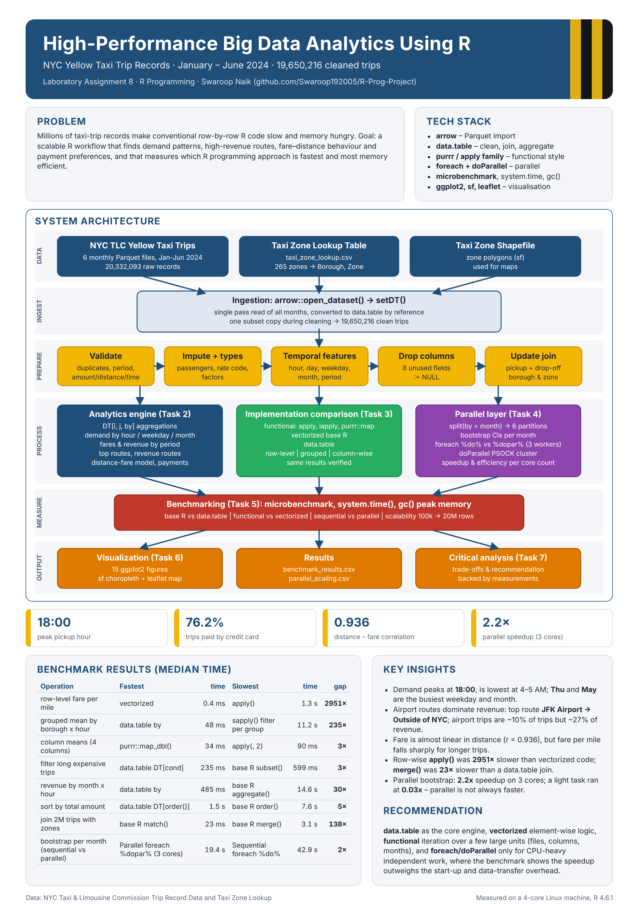

# High-Performance Big Data Analytics Using R – NYC Yellow Taxi Trips

**Laboratory Assignment 8 – R Programming** · Swaroop Naik

A scalable R analytics workflow for about **20 million NYC Yellow Taxi trips (January–June 2024)**. It covers
data preparation with **data.table**, transportation analytics, a comparison of **functional vs vectorized vs
data.table** programming, **sequential vs parallel** processing with `foreach` + `doParallel`, benchmarking with
`microbenchmark`, and visualizations with **ggplot2**, **sf** and **leaflet**.



## Repository contents

| Path | Description |
|---|---|
| `NYC_Taxi_BigData_Analytics.ipynb` | Main notebook (R kernel), executed with all outputs |
| `NYC_Taxi_BigData_Analytics.pdf` | PDF export of the notebook (for submission) |
| `R/nyc_taxi_analysis.R` | Same code as a plain R script |
| `poster/architecture_poster.pdf` / `.png` / `.html` | A3 architecture poster |
| `outputs/figures/` | All figures (PNG) |
| `outputs/benchmark_results.csv` | Execution-time comparison table |
| `outputs/parallel_scaling.csv` | Parallel speedup per number of cores |
| `outputs/leaflet_top_revenue_zones.html` | Interactive leaflet map |

Notebook structure: Problem Statement → Dataset → Data Preparation (Task 1) → Analytics (Task 2) →
Functional/Vectorized/data.table (Task 3) → Parallel Computing (Task 4) → Benchmarking (Task 5) →
Visualizations (Task 6) → Observations → Critical Analysis (Task 7) → Conclusion.

## Dataset

* NYC TLC Yellow Taxi Trip Records, Jan–Jun 2024 – <https://www.nyc.gov/site/tlc/about/tlc-trip-record-data.page>
* Taxi Zone Lookup Table and Taxi Zone shapefile (same page)

The raw data (about 340 MB of Parquet files) is **not stored in the repository**. The notebook downloads it into
`data/` the first time it runs.

## How to run

1. Install **R ≥ 4.2** and **Jupyter**, then register the R kernel:
   ```r
   install.packages("IRkernel"); IRkernel::installspec()
   ```
2. Install the R packages. The first notebook cell also installs any that are missing:
   ```r
   install.packages(c("data.table", "arrow", "ggplot2", "foreach", "doParallel", "microbenchmark",
                      "purrr", "lubridate", "scales", "hexbin", "leaflet", "htmlwidgets", "sf"))
   ```
3. Clone the repository and start Jupyter from the repository root:
   ```bash
   git clone https://github.com/Swaroop192005/R-Prog-Project.git
   cd R-Prog-Project
   jupyter notebook NYC_Taxi_BigData_Analytics.ipynb
   ```
   Then choose **Kernel → Restart & Run All**. The plain script runs the same steps:
   ```bash
   Rscript -e 'source("R/nyc_taxi_analysis.R", print.eval = TRUE)'
   ```
4. Export the PDF for submission: **File → Save and Export Notebook As → PDF / Webpdf**, or run
   `jupyter nbconvert --to webpdf NYC_Taxi_BigData_Analytics.ipynb`.

**Memory:** all six months need about 10–12 GB of RAM. On an 8 GB machine, set
`MONTHS <- sprintf("2024-%02d", 1:3)` in the setup cell. A full run takes about 12 minutes on 4 cores.
Benchmark times and parallel speedups depend on the machine, so your numbers will differ slightly.

## Key results (reference run, 4-core machine)

| Metric | Result |
|---|---|
| Trips analysed | 19,650,216 clean of 20,332,093 raw records |
| Peak demand | 18:00, busiest weekday Thursday, busiest month May |
| Revenue | airport trips ≈ 10 % of trips but ≈ 27 % of revenue; top route JFK Airport → Outside of NYC |
| Distance vs fare | correlation 0.936; standard rate ≈ 6 USD + 3.9 USD per mile |
| Payments | credit card 76.2 %, cash ≈ 13.5 % |
| Row-level: apply() vs vectorized | 1.3 s vs 0.4 ms (2951× slower) |
| Grouping 20M rows: aggregate() vs data.table | 14.6 s vs 485.4 ms (30×) |
| Join 2M rows: merge() vs data.table | 3.1 s vs 132.7 ms (23×) |
| Bootstrap per month: sequential vs parallel (3 cores) | 42.8 s vs 19.4 s (2.2× speedup) |
| Light task in parallel | 0.03× – slower than sequential because of data-transfer overhead |

## Recommendation

Use **data.table** as the core engine (import, clean, join and aggregate by reference) and write element-wise
logic in **vectorized** form. Use **functional programming** (`lapply` / `purrr::map`) to iterate over a few large
units such as files, columns or partitions. Add **foreach + doParallel** only for CPU-heavy, independent work,
and only after a benchmark shows that the speedup outweighs the start-up and data-transfer overhead.
